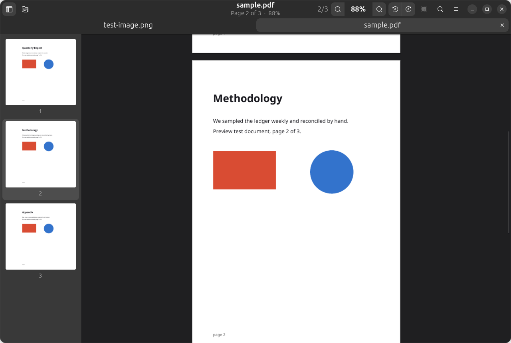

# Preview

A native image and PDF viewer for the Linux desktop, in the spirit of the macOS
app of the same name. Built with GTK4 and libadwaita, packaged as a `.deb`.



## Features

- **Images and PDFs** — every format the system has a GdkPixbuf loader for
  (PNG, JPEG, WebP, AVIF, HEIC, JPEG XL, TIFF, SVG, BMP, ICO…) plus multi-page
  PDF documents.
- **Tabs** — several documents open at once, each keeping its own zoom, page
  and search state.
- **Thumbnail sidebar** — rendered lazily, so a long PDF does not stall on open.
- **Zoom** — fit, fill, actual size, 5%–1600% in steps, and Ctrl+scroll to zoom
  at the pointer. Pixels stay crisp past 250% instead of being smeared.
- **Rotation** in 90° steps, applied as a view transform so it is instant.
- **Find** across PDF text, with match highlighting and next/previous.
- **Selection, crop and export** between image formats.
- **Slideshow and fullscreen**, printing via the standard GTK dialog.
- Follows the system light/dark theme.

## Install

```bash
sudo apt install ./preview_1.0.0_all.deb
```

`apt` pulls the dependencies. To install the built file with `dpkg` instead,
run `sudo dpkg -i preview_1.0.0_all.deb && sudo apt-get -f install`.

### Recommended extras

Both are pulled in by `Recommends`, and Preview degrades gracefully without
them:

| Package | What it adds |
| --- | --- |
| `gir1.2-poppler-0.18` | In-process PDF rendering and word-level search highlighting. Without it Preview falls back to the `poppler-utils` command line tools, which render fine but report page hits without highlight boxes. |
| `python3-gi-cairo` | Printing. The viewer itself does not need it. |

## Build

```bash
./packaging/build-deb.sh
```

Produces `dist/preview_<version>_all.deb`. No root needed — `dpkg-deb` builds
from a staging tree. Run from a checkout without installing:

```bash
./bin/preview path/to/file.pdf
```

## Tests

```bash
python3 tests/test_preview.py
```

These cover the document, surface, export and settings layers and need no
display.

## Keyboard shortcuts

| Keys | Action |
| --- | --- |
| `Ctrl+O` / `Ctrl+W` | Open / close tab |
| `Ctrl++` `Ctrl+−` | Zoom in / out |
| `Ctrl+0` / `Ctrl+9` / `Ctrl+8` | Actual size / fit / fill |
| `Ctrl+scroll` | Zoom at the pointer |
| `Ctrl+L` / `Ctrl+R` | Rotate left / right |
| `F9` | Thumbnail sidebar |
| `Ctrl+F`, `Ctrl+G`, `Ctrl+Shift+G` | Find, next match, previous match |
| `Page Up` / `Page Down` | Scroll by a screenful |
| `Alt+←` / `Alt+→` | Previous / next page |
| `Ctrl+Home` / `Ctrl+End` | First / last page |
| `Ctrl+Shift+J` | Go to page |
| `Ctrl+A` / `Ctrl+K` | Selection tool / crop to selection |
| `Ctrl+Shift+S` / `Ctrl+P` | Export as / print |
| `F11` / `Ctrl+Shift+F` | Fullscreen / slideshow |
| `Esc` | Dismiss find, selection, slideshow or fullscreen |

## How it renders

Pages are rasterised with Cairo on a background thread and handed to the widget
layer as `Gdk.Texture` objects composited through GSK render nodes. Nothing in
the widget path touches a Cairo context, so Preview draws correctly even when
the `python3-gi-cairo` foreign-struct bridge is not installed — a case where a
conventional `Gtk.DrawingArea` draw function fails outright.

Textures are cached per `(page, scale)` under a pixel budget and evicted
least-recently-used. Rotation is a paint-time transform, so turning a document
never invalidates the cache. While a page is still rendering at a new zoom, the
nearest cached scale is stretched in its place, which keeps zooming responsive
even on the slower `pdftoppm` fallback path.

## Layout

```
preview/
├── app.py          Adw.Application, CSS, command line
├── window.py       Window: tabs, header bar, actions, dialogs
├── docview.py      One open document: sidebar + page view + find bar
├── canvas.py       Page layout, zoom, rotation, async render cache
├── sidebar.py      Thumbnail list
├── document.py     Backend dispatch
├── surface.py      GdkPixbuf <-> Cairo <-> Gdk.Texture bridge
├── export.py       Export As, crop, format conversion
├── printing.py     GTK print dialog
├── config.py       Window state and recent files
└── backends/
    ├── image.py    GdkPixbuf-backed images
    └── pdf.py      Poppler GIR, with a poppler-utils fallback
```

## License

MIT. See `packaging/copyright`.
